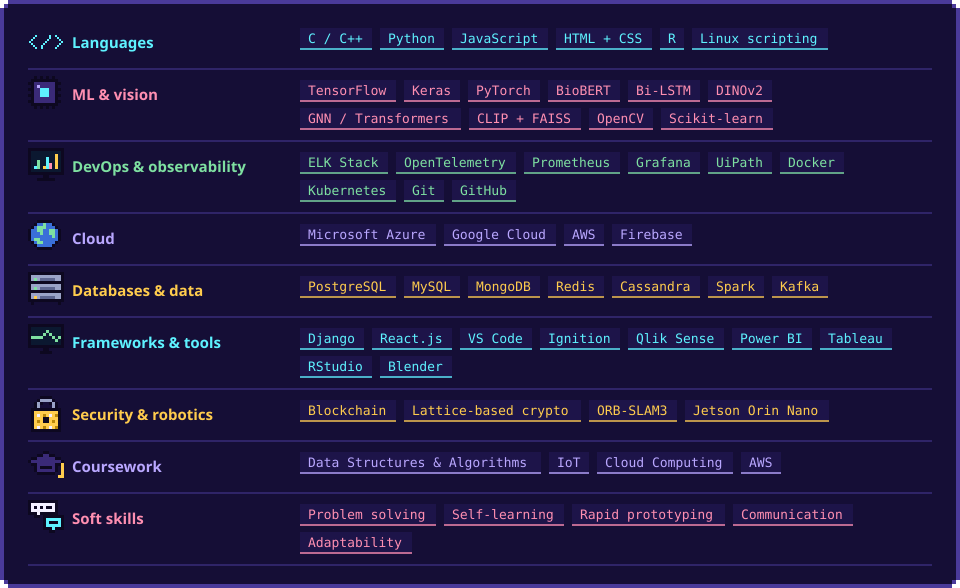

  <a href="mailto:harshavarthansami@gmail.com"><b>Email</b></a> &nbsp;·&nbsp;
  <a href="https://in.linkedin.com/in/harshavarthan-s"><b>LinkedIn</b></a> &nbsp;·&nbsp;
  <a href="https://github.com/harshav111"><b>GitHub</b></a>

## 👋 About

I build systems that have to work where nobody is around to fix them: clinical decision support for rural hospitals in Tamil Nadu, a SLAM stack that corrects its own drift on a Jetson, and a post-quantum ledger for railway signalling.

Right now I spend my days on observability and automation at **DHL GSC** and my evenings on deep learning for biomedical signals with **IEEE EMBS at IIT Kharagpur**.

---

## 💼 Experience

| When | Role | What I did |
|:--|:--|:--|
| **Aug 2026 – now** | **Summer Research Intern** IEEE EMBS SBC, IIT Kharagpur | Deep learning for biomedical signal processing under faculty guidance |
| **Jul 2026 – now** | **Process Automation Intern** DHL GSC | ELK, OpenTelemetry, Prometheus and Grafana observability across Azure and GCP; UiPath automation |
| **May – Jul 2026** | **Summer Intern** NIT Trichy, Centre for Digital Infrastructure | Built and deployed internal web applications, from requirements to deployment |
| **Jun – Aug 2024** | **Junior Software Developer Intern** Avivo AI LLC | LLM and RAG systems, vector databases, React integration |
| **Nov 2023 – Mar 2024** | **System Administrator** SUNFLEX Global Energy | Website uptime, DNS and domain management, task automation |
| **Jun – Jul 2023** | **Summer Intern** Hyundai Motor India Limited | Ticket management system with Ignition, MS SQL and Python; Qlik Sense analytics |

---

## 🚀 Projects

<table>
<tr>
<td width="50%" valign="top">

**🔐 Post-Quantum Blockchain for Railway Signalling**
 Jun 2026 – now

Blockchain security architecture using lattice-based cryptography for quantum-resistant authentication and data integrity.

</td>
<td width="50%" valign="top">

**🤖 Neural-SLAM-Zero**
 Jan 2026 – now · IFPS funded

Self-supervised graph-transformer that corrects SLAM drift, targeting >40% lower trajectory error with under 15 ms overhead on a Jetson Orin Nano.

</td>
</tr>
<tr>
<td width="50%" valign="top">

**🩺 Multilingual Clinical Decision Support**
 Nov 2025 · IEEE Xplore

Hybrid BioBERT + Bi-LSTM system for rural healthcare, covering neonatal sepsis, marasmus and tuberculosis. [Paper](https://doi.org/10.1109/ISCS69371.2025.11385867)

</td>
<td width="50%" valign="top">

**🏥 Patient Outcome Enhancement**
 Mar 2025 · 🏆 Best Paper

AI-based CDSS for status asthmaticus and diabetic ketoacidosis with 90% severity-prediction accuracy.

</td>
</tr>
<tr>
<td colspan="2" valign="top">

**📡 U2R Attack Detection in Wireless Networks**
 Apr 2024 · ACROSET 2024

CNN AlexNet model with higher attack-detection precision than SVM baselines. [Paper](https://doi.org/10.1109/ACROSET62108.2024.10743609)

</td>
</tr>
</table>

---

## 📚 Publications

| | Paper | Venue | |
|:-:|:--|:--|:-:|
| 1 | **An AI-Driven Approach for Enhancing Patient Healthcare in Resource-Constrained Rural Areas** | CRC Press, Ch. 12 | [DOI](https://doi.org/10.1201/9781003777458-12) |
| 2 | **A Multilingual AI-Driven Clinical Decision Support System for Rural Healthcare** | IEEE ISCS 2025 | [DOI](https://doi.org/10.1109/ISCS69371.2025.11385867) |
| 3 | **NewsImages: CLIP–FAISS Retrieval and Diffusion-Based Generation for Editorial News Thumbnails** | MediaEval 2025 | [PDF](https://2025.multimediaeval.com/paper46.pdf) |
| 4 | **Effective Forecasting for U2R Attacks in Wireless Networks: CNN AlexNet vs SVM** | IEEE ACROSET 2024 | [DOI](https://doi.org/10.1109/ACROSET62108.2024.10743609) |
| 5 | **AI-Driven Patient Outcome Enhancement in Resource-Constrained Rural Areas** | Taylor & Francis | *in press* |

---

## 🛠️ Skills

---

## 🎓 Education &nbsp;·&nbsp; 🏆 Achievements

| 🎓 Education | 🏆 Achievements |
|:--|:--|
| **M.E. CSE**, SSN College of Engineering 2025 – 2027 · CGPA 8.6 | **Best Paper Award**, Next Gen International Conference, SRM (2025) |
| **B.Tech CSE (Data Science)**, Periyar Maniammai University 2021 – 2025 · CGPA 7.9 | **IFPS Research Grant**, SSN College of Engineering |
| | **First Prize**, CODEX Hackathon (2024) |
| | **IELTS** Band 6.5 · **Honeywell** Data Analytics certified |

---

